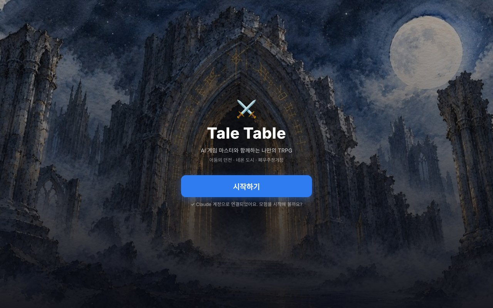
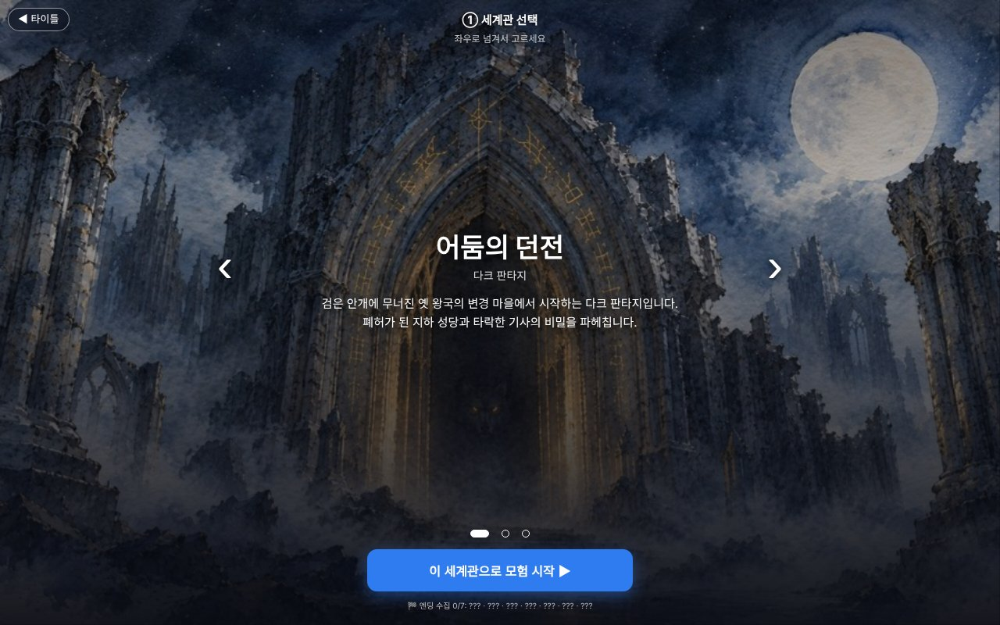
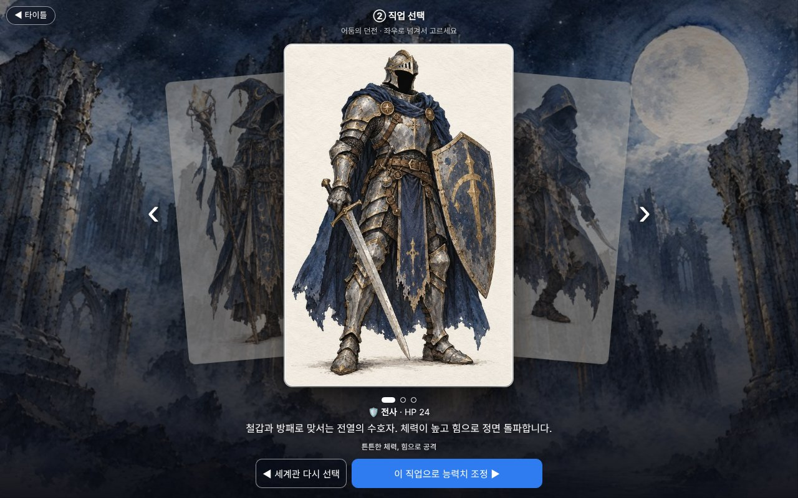
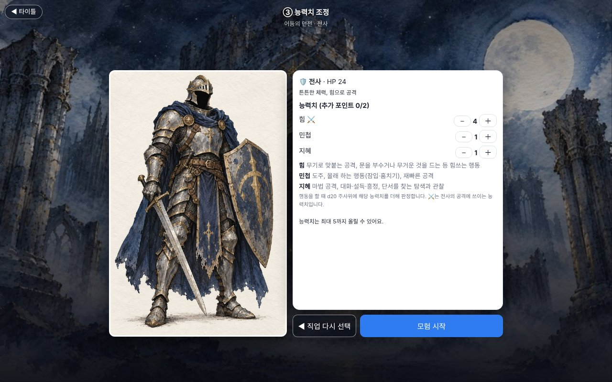
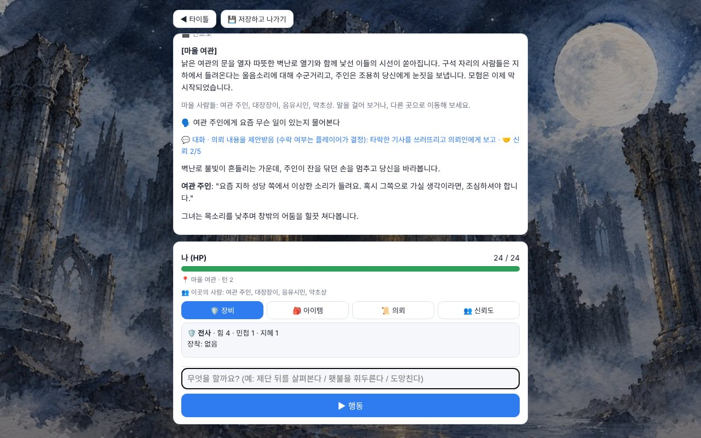

# ⚔️ Tale Table – AI 게임 마스터와 함께하는 나만의 TRPG

> AI응용게임기획및프로그래밍 기말 프로젝트

Tale Table은 **AI가 게임 마스터(GM)를 맡는 1인용 웹 TRPG**입니다.
플레이어는 선택지 버튼이 아니라 **자연어로 행동을 입력**하고, AI가 그 행동을 해석해 장면을 묘사하고 NPC를 연기합니다.
주사위·HP·판정·엔딩 조건 같은 **규칙 계산은 코드가 담당**해서, AI 서술이 자유로워도 게임 규칙은 흔들리지 않습니다.



## ▶ 플레이

- **게임 링크 (Claude 아티팩트)**: https://claude.ai/artifact/M2Ebvt1csWb9ezcwmfuFSE
  - Claude 계정으로 로그인하면 바로 플레이할 수 있습니다. AI 사용량은 플레이어 본인 Claude 요금제에서 차감되며, 서버나 API 키가 필요 없습니다.
- **독립 실행**: `index.html`을 브라우저로 열고 타이틀의 🔌 AI 연결에서 API 키(Claude / Gemini / OpenRouter)를 입력하면 플레이할 수 있습니다.
  - 파일을 더블클릭해 열 때 요청이 막히면 `python -m http.server` 실행 후 `http://localhost:8000` 으로 접속하세요.

## 🎮 주요 기능

| 구분 | 내용 |
|---|---|
| 세계관 3종 | 🏰 어둠의 던전(다크 판타지) · 🌃 네온 도시(사이버펑크 느와르) · 🚀 폐우주정거장(SF 공포) |
| 캐릭터 | 세계관별 직업 3종 + 능력치(힘·민첩·지혜) 추가 포인트 2점 배분 |
| 자연어 행동 | "제단 뒤를 살펴본다", "여관 주인에게 소문을 묻는다"처럼 자유롭게 입력 → AI가 공격·탐색·도주·아이템·이동·대화 등으로 분류 |
| d20 판정 | d20 + 능력치 vs 난이도(DC). 결과는 코드가 계산, AI는 결과를 바꾸지 않고 묘사만 함 |
| NPC | 세계관마다 의뢰인·조력자·마을 사람 등 NPC 5명. 성격·말투·숨은 사정을 가진 NPC를 AI가 연기, 신뢰도 시스템 |
| 의뢰 분기 | 수락 / 거절 / 흥정, 조력자에게 부탁 / 설득 / 절도, 최종 적 처치 / 설득, 정직 / 거짓 보고 |
| 엔딩 7종 + 수집 | 정석 클리어 · 평화의 해결 · 자유로운 모험가 · 영웅의 귀환 · 맺어진 인연 · 배신자 · 패배 |
| 저장 | 3턴마다 자동 저장, 저장하고 나가기, 타이틀에서 이어하기 / 저장 삭제 |
| 연출 | 수채화풍 세계관·직업 일러스트, 프롤로그·인트로 연출, 텍스트 단계 표시(다음 / 자동 / 건너뛰기) |

## 🧩 구조

```
플레이어 입력 (자연어)
   │
   ▼
[AI ①] 행동 분류기 ── JSON {type, stat, difficulty, item, dest, intent, npc}
   │
   ▼
[코드] 규칙 엔진 ── d20 판정, HP/피해, 아이템, 이동, 의뢰·신뢰도 플래그, 엔딩 조건
   │
   ▼
[AI ②] GM 서술 ── 판정 결과를 바꾸지 않고 장면·NPC 대사·후일담 묘사 (JSON)
   │
   ▼
화면 출력 + 상태 저장(localStorage)
```

- **역할 분리 원칙**: AI = 해석과 서술 / 코드 = 숫자와 규칙. AI에게 계산을 맡기지 않아 일관성을 지킵니다.
- **AI 연결 자동 전환**: claude.ai 아티팩트 안에서는 `window.claude.use("sample")`로 플레이어 계정 연결, 밖에서는 BYOK(API 키) 어댑터 사용.
- **단일 파일**: HTML·CSS·JS·일러스트(base64)가 `index.html` 하나에 들어 있습니다.

## 📸 화면

| 세계관 선택 | 직업 선택 |
|---|---|
|  |  |
| **능력치 조정** | **게임 시작** |
|  |  |
| **플레이 (NPC 대화)** | |
|  | |

## 📝 문서

- [개발 프롬프트 기록 & 게임 내 AI 프롬프트](docs/PROMPTS.md)

## 🛠 개발 도구

- 개발: Claude (대화형 AI 코딩) — 기획, 코드 작성, 테스트(Playwright)
- 일러스트: 이미지 생성 AI (프롬프트는 Claude로 작성)
- 실행 환경: 웹 브라우저 (HTML / CSS / JavaScript)
